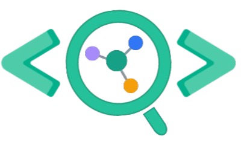
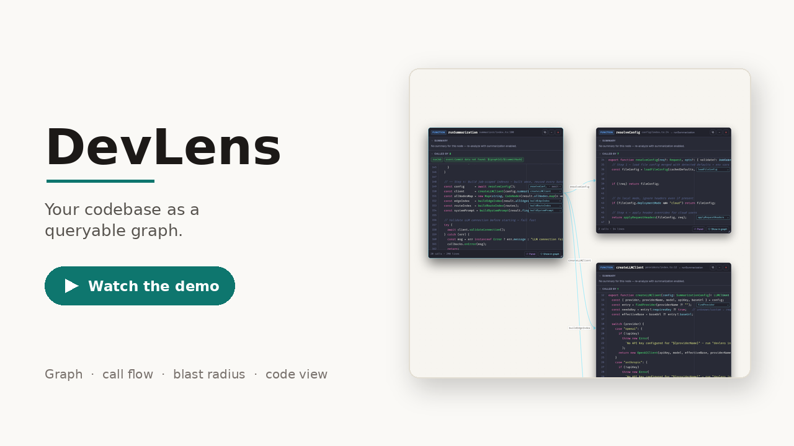
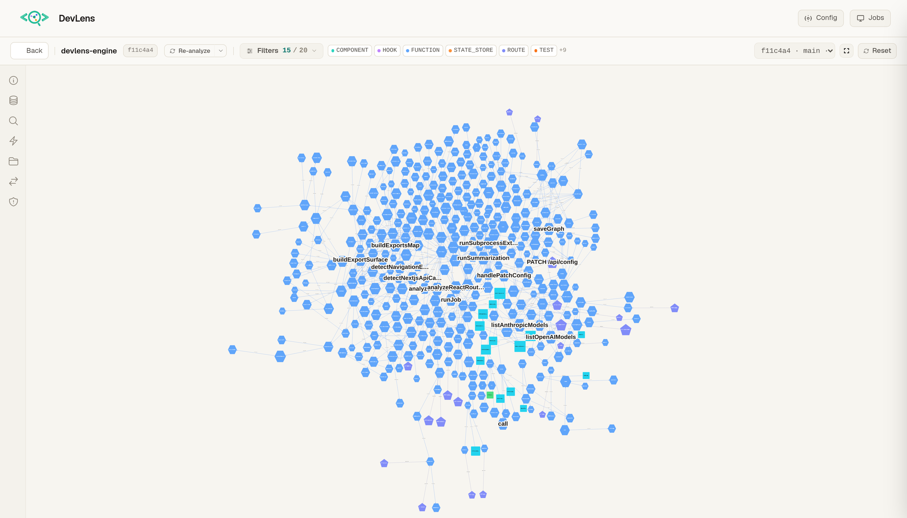
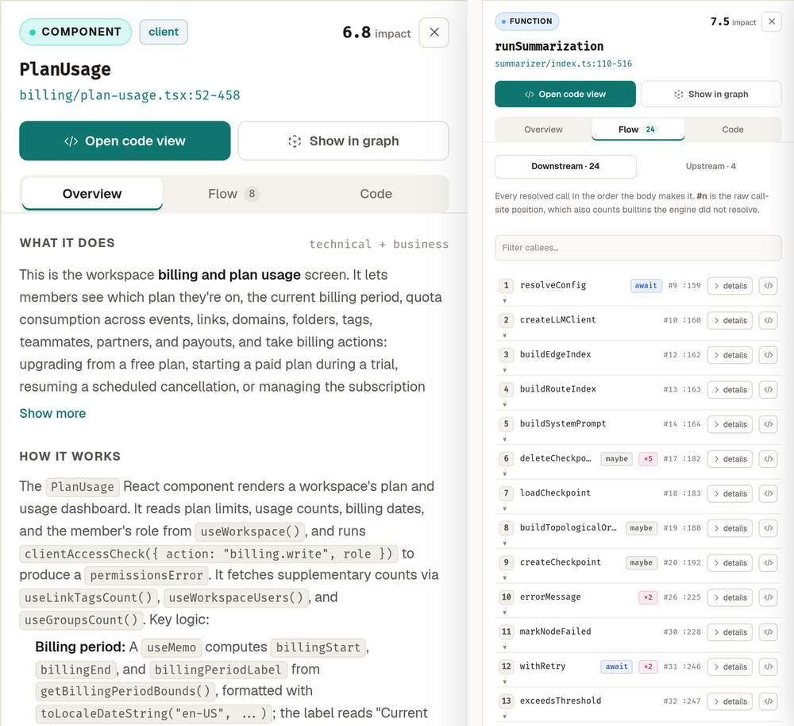
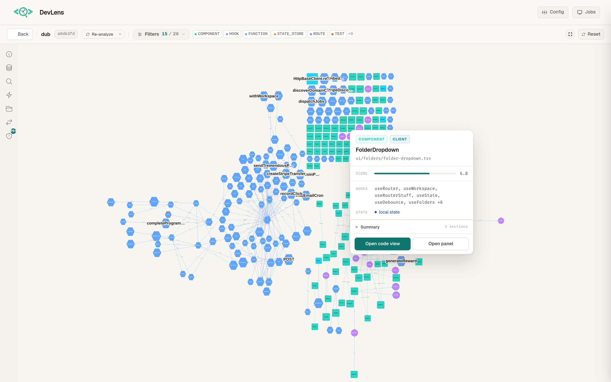
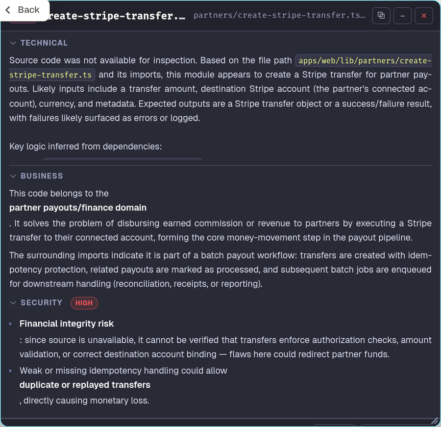
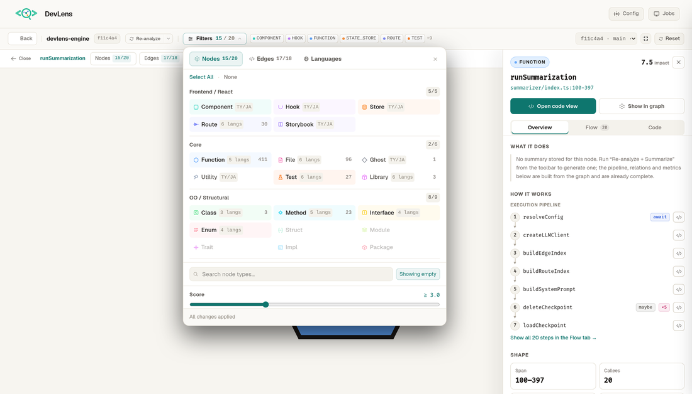
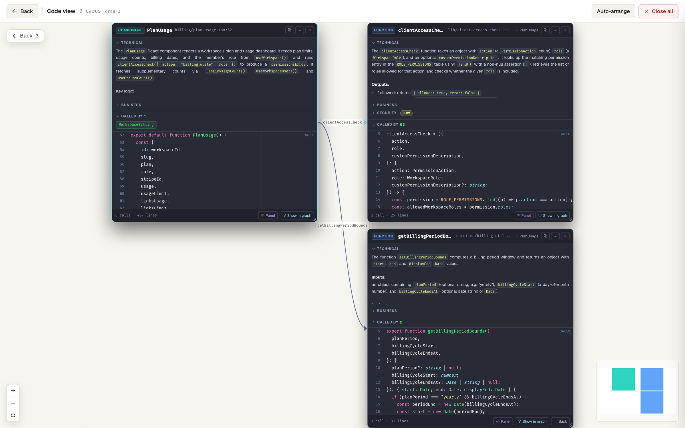
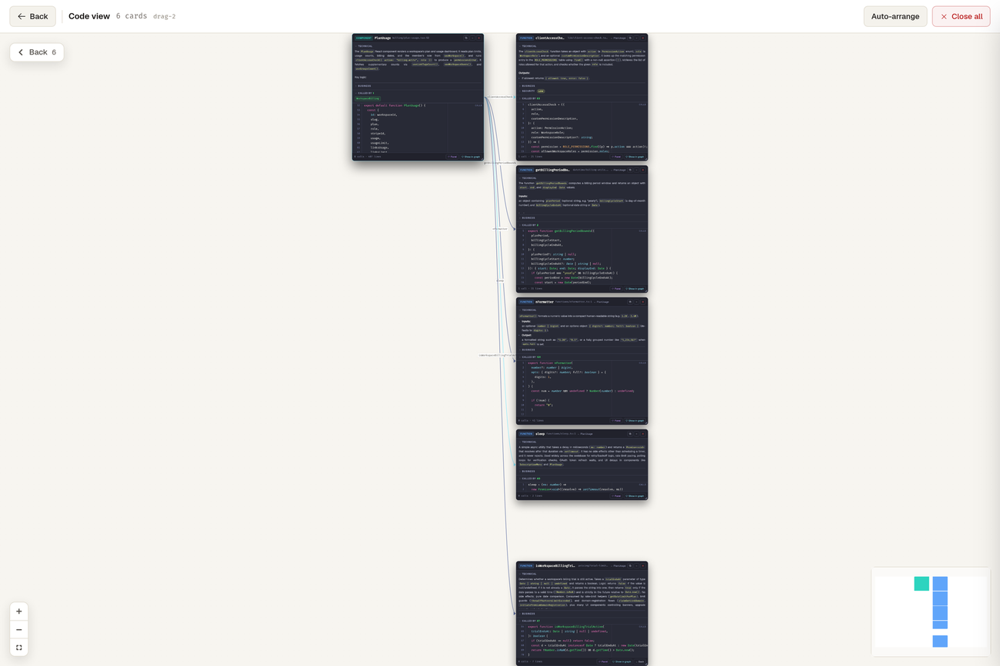
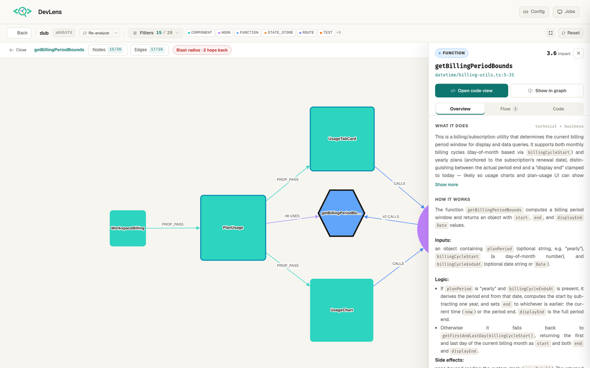

<div align="center">



# DevLens

**Codebase Intelligence for AI agents and Developers.**

Analyze your repo once, then **open a code graph you can actually read**: every file, route, hook and class is a node you can search, follow and open. Click a function to see what it does in plain language, what it calls in order, who calls it, and what breaks if you change it. The same graph backs five self-describing MCP tools, so your agent works from what you are looking at instead of re-reading the repo file by file.

[](https://www.gnu.org/licenses/agpl-3.0)
[](https://www.npmjs.com/package/@devlensio/cli)
[](https://bun.sh)

**[Join the DevLens Cloud Waitlist →](https://devlens.io)**

</div>

---

[](https://www.youtube.com/watch?v=oHQT35Lv6_k)

<p align="center"><em>Click the image to know more about Devlens</em></p>

<sub>**Jump to:** [The Web UI](#see-it-the-web-ui) · [Why DevLens](#why-devlens) · [Quick Start](#quick-start) · [CLI](#cli) · [What your agent can ask](#what-your-agent-can-ask) · [Benchmarks](#benchmarks) · [Node and edge types](#what-devlens-understands)</sub>

---

## See it: the Web UI

The CLI answers one question at a time. The Web UI shows the whole codebase at once and lets you move through it — this is the part developers keep open in a tab.



*One real repository, 591 nodes. The highest-impact nodes keep their labels at overview zoom, so the first screen tells you where the weight sits instead of showing an unlabelled hairball.*

| In the UI | What you get |
| :-- | :-- |
| **A map of the architecture** | Files, components, hooks, routes, classes, methods and tests as typed nodes, connected by `CALLS`, `IMPORTS`, `EXTENDS`, `IMPLEMENTS`, `RENDERS`, `READS_FROM` / `WRITES_TO` and route edges. Sized by importance, so the spine of the app is visible before you click anything. |
| **A written answer per node** | Every node carries a **technical** summary, a **business** summary and a **security** verdict with severity — written from the code, not from its name. |
| **Execution flow, in order** | The **Flow** tab lists every resolved call, **hook call** and **rendered child**, numbered by position in the body, marked `await`, `maybe`, `loop`, `×N`. Children carry `conditional` when they sit behind a branch — nothing is abstracted into "and 18 more". |
| **Both directions** | Flip to **Upstream** for a collapsible tree of everything that reaches this node. |
| **Code as a graph** | The **code view** turns nodes into draggable cards with syntax highlighting; call badges sit on the exact lines that make the call, and clicking one opens the callee beside it. |
| **Blast radius** | Pick a hop depth and open everything that depends on this node — or everything it reaches — as its own subgraph. |
| **Filters that keep the plot** | Node type, edge type, score threshold, rendering boundary, entry-point reach, with live counts from your graph. |

### Inside the app

<table>
<tr>
<td width="50%" valign="top"></td>
<td width="50%" valign="top"></td>
</tr>
<tr>
<td valign="top"><em>Left: everything known about one node — technical summary, the pipeline its body runs, who calls it. Right: the same node's <b>Flow</b>, 24 resolved calls in body order with <code>await</code> / <code>maybe</code> / <code>×5</code> markers.</em></td>
<td valign="top"><em><b>Hover</b> without committing: score, hooks, local state, a collapsed summary, and the two ways in. The graph, toolbar and filters stay where they are.</em></td>
</tr>
<tr>
<td width="50%" valign="top"></td>
<td width="50%" valign="top"></td>
</tr>
<tr>
<td valign="top"><em>Inside a code card: <b>technical</b>, <b>business</b> and <b>security</b> are independent sections, technical open by default. Security carries its severity (<code>HIGH</code> here).</em></td>
<td valign="top"><em>Filter by node type, edge type, score, rendering boundary and entry-point reach, with live counts from your graph.</em></td>
</tr>
<tr>
<td width="50%" valign="top"></td>
<td width="50%" valign="top"></td>
</tr>
<tr>
<td valign="top"><em>Two callees open beside their caller — the common case while reading. Click a badge to add a card, <b>Auto-arrange</b> to lay them out.</em></td>
<td valign="top"><em>The same view at six cards: a call tree on one canvas, arrows showing direction, <b>Back</b> closing them one at a time.</em></td>
</tr>
<tr>
<td width="50%" valign="top"></td>
<td width="50%" valign="top"></td>
</tr>
<tr>
<td valign="top"><em><b>Blast radius</b> at two hops: everything that would feel the change. <b>K-hop</b> shows the reverse — what this node reaches.</em></td>
<td valign="top"></td>
</tr>
</table>

Two details the pictures hint at: open any step in the flow to read its source, with the callee's summary nested underneath and collapsed until you ask for it; and the panel's own **Code** tab shows the node's source with the file's real line numbers, so you can read without leaving the graph or opening your editor.

Routes read the same way with one difference: a route has no body, so step 1 is the component (or handler) that serves the URL, and the numbered calls under it are that component's. Upstream on a route is the set of components holding a link to it — every way a user can arrive.

Components get one extra section, **Renders**: the children they put on screen, each with the file it is defined in. Most render edges cross a file, so that path is the part you cannot get by reading the parent — plus `×N` for a child written more than once, `list` for one rendered per item of a `map()`, and the props crossing the boundary.

Analyses and summarizations run as jobs inside the same app: per-phase progress, resumable, and the engine's own error text when a provider fails.

Every shape and arrow in that legend is listed — node types, edge types, and what each one means — under [What DevLens understands](#what-devlens-understands).

### A five-minute pass over an unfamiliar repo

1. **Orient.** Open the graph. Bigger, labelled nodes are where the weight is.
2. **Pick an entry point.** Search a route or handler you already understand, or toggle entry-point reach to light up everything the app actually runs.
3. **Read the flow.** The **Flow** tab tells you what that function does, in order, before you open a single file.
4. **Check the blast radius.** Two hops back shows what breaks if you change it.
5. **Open the code view.** The cards put the function and its callees side by side, so you stop alt-tabbing between files.
6. **Keep what you learned.** Filters, commit diffs and one-click reindex make the view reusable next sprint.

### How teams use it

- **Onboarding.** A new hire traces a feature from route to handler to hook to component in minutes, with prose summaries instead of tribal knowledge.
- **PR review.** Load the PR's commit, diff it against the base, see which nodes were added, removed or re-scored — then check the blast radius of the risky ones.
- **Refactor planning.** Sort by score, find the god-nodes, confirm dependency direction before you split anything.
- **Incident triage.** Start from the failing route, walk the flow, look at what reads the data that broke.
- **Agent grounding.** The same graph backs the MCP server, so what your agent answers and what you see on screen cannot disagree.

### Run it

From a clone of this repository. You need **Bun 1.2 or newer** (`bun --version`); Next 16 also wants Node 20.9+ on the machine, which Bun ships with.

```bash
bun install   # once — installs the API, the UI and the engine's dependencies
bun start     # API + Web UI on one port → http://localhost:3000
```

`bun start` builds the UI on first run and then serves everything from port 3000; the Next.js server it proxies to listens on 3001 internally, so browse **3000**. The Web UI runs from the source tree — it is not bundled into the installed CLI binary.

### Configure a model (optional, needed for summaries)

Analysis works with no API key: you get the graph, the flows and the blast radius. **Summaries** (technical / business / security) need a model. Two ways to set one up:

**From the UI** — click **Config** in the top-right corner, then:

1. **Provider** — pick the protocol: `OpenAI-compatible` for anything speaking `/chat/completions`, `Anthropic` for the Messages API.
2. **Name** — a label for this endpoint (e.g. `my-gateway`), used when several are configured.
3. **Base URL** — the API root, usually ending in `/v1` (e.g. `https://api.example.com/v1`).
4. **API Key** and **Model** — the key, and the exact model id the endpoint expects.
5. **Save**, then **Set active** so the UI and the CLI use it.

**From the CLI** — `devlens init` walks the same fields interactively. Either path writes `~/.devlens/config.json`, so the UI, the CLI and the MCP server always agree.

Then analyze a repo with summarization enabled (the toggle on the home screen). If a provider fails mid-run, the job reports which nodes failed and keeps everything that succeeded — re-run to retry just those.

---

## Why DevLens?

Most tools answer "where is this symbol". DevLens answers the three questions that actually slow you down when you join a repo or come back to one six months later.

- **"What is this codebase?"** One screen shows the architecture: routes, handlers, hooks, components and stores as typed, sized nodes. The spine is visible before you open a file — which is what makes an unfamiliar repo navigable instead of a folder tree you have to guess at.
- **"What does this thing do, and what runs when it runs?"** Every node carries a written technical and business summary, plus its body's calls in execution order with `await`, `maybe`, `loop` and `×N` markers. You read the behaviour, not just the signature.
- **"What breaks if I change it?"** Blast radius in one click, either direction, at any hop depth — before the change, not in review.
- **It tracks the code, not a snapshot.** Each analysis is tied to a commit: load a PR's commit, diff it against the base, and see which nodes were added, removed or re-scored. Re-running keeps the summaries of unchanged nodes, so you only pay for what moved.
- **You navigate, you don't scroll.** Search by name or ID, hover for a card, click for the panel, open a node as a code card, follow its callees, walk back up with **Called by**. A graph you move through beats a diagram you stare at.
- **Security lives in the graph.** Per-node severity plus what that finding can reach, so a `HIGH` on a payout handler is not confused with a `HIGH` on a test fixture.
- **The agent sees what you see.** The MCP server reads the same graph, so agent answers and the UI cannot disagree — one analysis, two front doors.

If you only want retrieval for an agent, the [benchmarks](#benchmarks) are further down. This repository is built UI-first because that is where the understanding happens.

---

## Quick Start

There are two ways in, and they share one analysis:

- **The CLI** — installed from npm, for scripts, CI and your coding agent. Steps below.
- **The Web UI** — runs from a clone, for exploring a repo by hand: [See it: the Web UI](#see-it-the-web-ui).

### Step 1 — Install the CLI

```bash
npm install -g @devlensio/cli
```

Or install the standalone binary (no Node.js needed):

```bash
# Linux / macOS
curl -fsSL https://raw.githubusercontent.com/devlensio/devlensOSS/main/scripts/install.sh | sh

# Windows (PowerShell)
irm https://raw.githubusercontent.com/devlensio/devlensOSS/main/scripts/install.ps1 | iex
```

### Step 2 — Configure a model (optional)

Only needed if you want AI summaries. Structure-only analysis works offline with no API key.

```bash
devlens init
```

This walks you through picking a provider, API type, key, endpoint, and model interactively — press **ESC** at any step to go back a stage. It writes the same `~/.devlens/config.json` as the [UI walkthrough](#configure-a-model-optional-needed-for-summaries); see [Configuration](#configuration) for recommended models.

### Step 3 — Analyze your repo

```bash
cd your-project
devlens analyze . --summarize
```

This builds the graph, generates summaries, and creates the search index — once. After this, everything below is instant.

### Step 4 — Connect your AI agent

Start the MCP server:

```bash
devlens mcp
```

Then register it in your agent. Pick your tool:

**Claude Code / Claude Desktop**

```bash
claude mcp add devlens -- devlens mcp
```

**Cursor** — add to `.cursor/mcp.json`:

```json
{
  "mcpServers": {
    "devlens": { "command": "devlens", "args": ["mcp"] }
  }
}
```

**Codex** — add to `~/.codex/config.toml`:

```toml
[mcp_servers.devlens]
command = "devlens"
args = ["mcp"]
```

**Hermes** — add to `config.yaml`:

```yaml
mcp:
  servers:
    devlens:
      command: devlens
      args: [mcp]
```

**Any other MCP client** — the server speaks standard MCP over stdio. Point your client at the command `devlens mcp`. For an HTTP transport instead:

```bash
devlens mcp http -p 7000
```

The server self-describes its full tool list through `tools/list`, so your agent discovers everything on its own. That's it — ask your agent "how does auth work in this repo?" and watch it query the graph instead of reading files.

---

## What your agent can ask

The server self-describes every tool's parameters through `tools/list` — your agent fills them in automatically. **Five tools, no `graphId` anywhere** — the repo is resolved from your working folder.

| Tool | Key arguments | What it does |
| :-- | :-- | :-- |
| `resolve_context` | `task` (required), `intent?`, `focus?`, `tokenBudget?` | **The front door.** One call returns a task-shaped plain-text packet: an ANSWER line, ranked nodes with one-line meanings, call flow, involved files with matched-line snippets, and an id map — all within a token budget. Intents: `pinpoint`, `reference-list`, `flow`, `overview`, `concept`, `security-audit`, `exploratory`. |
| `find_symbols` | `query` (required), `limit?` | Cheap BM25F name lookup: nodeIds plus `file:line`, no graph, no source. |
| `get_node` | `node` (required), `include?` | Full detail for one node: technical, business, and security summaries plus callers, callees, and (opt-in) raw source. |
| `impact` | `target?` or `from`+`to` commits | Change impact: what breaks if a symbol changes; commit-range diff mode for two analyzed commits. |
| `repo` | `action` | Manage analyzed graphs: `list`, `analyze`, `freshness`, `health`. |

Every response carries a `provenance` block (`commitHash`, `analyzedAt`, `hasGit`), so your agent always knows which snapshot answered the question.

> **Full reference:** [`docs/mcp-reference.md`](docs/mcp-reference.md)

---

## Supported languages

DevLens parses **five language families with native parsers** (no AI, no regex, no tree-sitter) and understands their frameworks. Summaries are never generated silently: you confirm before tokens are spent, and structure-only analysis needs no provider at all.

| Language | Frameworks / stacks the graph understands | What gets parsed |
| :-- | :-- | :-- |
| **TypeScript / JavaScript** | React, Next.js (app and pages router), Express/Hono/Fastify, React Router, TanStack Router, any Node | components, hooks, state stores, classes, methods, functions, routes |
| **Python** | FastAPI, Flask, Django (+DRF), SQLAlchemy / Django ORM, Celery, Pydantic | classes, methods, functions, routes, data models |
| **Java** | Spring Boot (controllers, JPA, Spring Data repositories) | classes, methods, interfaces, enums, routes |
| **Go** | net/http, Gin, Echo, chi, Fiber, GORM, database/sql | structs, interfaces, methods, functions, routes |
| **Rust** | axum, actix-web, rocket, utoipa, Diesel | structs, enums, traits, impl blocks, methods, functions, routes |

Each repo is analyzed with its language's own parser (Python `ast`, JavaParser, Go `go/ast` plus `go/types`, Rust `syn`, TS compiler API), so edges are real: type-checked interfaces (`IMPLEMENTS`), framework routes (`HANDLES`), and ORM data layers (`READS_FROM`, `WRITES_TO`).

---

## CLI

*For scripts, CI, and fast answers without leaving the terminal. Every command supports `--json` for piping into scripts, `-v/--verbose` for diagnostics, and `--quiet` for minimal output.*

**Analyze and summarize**

| Command | What it does |
|---------|--------------|
| `devlens detect [path] [--deps]` | Inspect a repo before analyzing: language, manifest, dependency count, source files |
| `devlens analyze [path] [--summarize] [--force-summarize]` | Build the graph and its search index (optionally add AI summaries) |
| `devlens summarize [target]` | (Re)generate technical, business, and security summaries |
| `devlens status` | Which repos are analyzed, their language and summary coverage |
| `devlens doctor` | Environment health check: git, storage, LLM provider, and the four extractor runtimes (go, rust, java, python) |
| `devlens init` | First-time setup: configure the LLM provider interactively |

**Explore and understand**

| Command | What it does |
|---------|--------------|
| `devlens overview` | Big picture: language, framework, stats, central nodes |
| `devlens top-nodes [-l <n>]` | Highest-scoring (most central) nodes |
| `devlens find-nodes <name> [-t <type>]` | Search by name, type, file, or severity (for example `-t ROUTE`) |
| `devlens nodes-in-path <path>` | All nodes in a file or folder |
| `devlens get-node <id>` | Full detail for one node: summaries, callers, callees |
| `devlens node-code <id>` | Raw source for a node (expensive, prefer `get-node`) |
| `devlens architecture` | One-call architecture brief: modules, routes, flows, health |
| `devlens get-context <query>` | Token-budgeted context packet for an agent |

**Impact and quality**

| Command | What it does |
|---------|--------------|
| `devlens blast-radius <id>` | What breaks if I change this (upstream dependents) |
| `devlens khop <id>` | What does it depend on (downstream) |
| `devlens subgraph <seed>` | The cohesive cluster (module) a node belongs to |
| `devlens cycles` | Circular dependencies |
| `devlens security [--min-severity ...]` | Security findings with severity and explanation |
| `devlens security-brief` | Ranked security report with blast-radius reach |
| `devlens diff <from> <to>` | Compare two analyzed commits |
| `devlens review-pr <from> <to>` | PR review packet: diff, impact, tests, security delta |
| `devlens check-freshness` | Is the graph stale versus HEAD? |

**Manage and integrate**

| Command | What it does |
|---------|--------------|
| `devlens config` | View or set LLM provider config (`~/.devlens/config.json`) |
| `devlens repos` | List analyzed repos |
| `devlens graphs list \| delete` | Manage stored graphs |
| `devlens reindex [graphId] [commitHash] [--force]` | Rebuild the local search index (`.search.json`) without re-analyzing. No arguments reindexes the latest commit of every graph |
| `devlens serve` | Start the backend HTTP API only (used by the MCP server and the Web UI) |
| `devlens mcp` | Run the MCP server (see [Quick Start](#quick-start)) |
| `devlens update [--check]` | Update the CLI to the latest published version — package manager auto-detected (npm/pnpm/yarn/bun). `--check` only checks and reports (pipeable with `--json`); offline, up-to-date, source-checkout, and non-global installs each get an explicit message |

**Hands-on examples**

```bash
devlens analyze . --summarize             # graph + summaries + search index
devlens find-nodes -t ROUTE               # every route in the app
devlens blast-radius "src/auth/login.ts::login"
devlens reindex                          # index everything up front
```

> **Full reference:** [`src/cli/README.md`](src/cli/README.md) for every command with options and examples.

---

## Benchmarks

We benchmarked DevLens MCP against the other code graph and retrieval tools — **Graphify, codegraph, semble, bm25** — on one headless coding agent, one model, one real TypeScript repository, and 133 real questions written from actual pull requests and symbols:

| | **DevLens V3 (5 tools)** | **Graphify** | codegraph | semble | bm25 |
| :-- | :-- | :-- | :-- | :-- | :-- |
| Correctness (agent loop, same run) | **0.643** | 0.619 | 0.667 | 0.714 | 0.667 |
| F1 (agent loop, same run) | **0.529** | 0.526 | 0.604 | 0.636 | 0.581 |
| Correctness (retrieval layer) | **0.694** | 0.662 | 0.674 | 0.652 | 0.664 |
| Response packet | **2,230 tokens** | 15,020 tokens | 6,339 tokens | 736 tokens | 721 tokens |
| Latency per call | **67 ms** | 2,469 ms | 2,736 ms | 508 ms | 108 ms |

Head-to-head against **Graphify** — the most direct competitor (tree-sitter graph, MCP server) — DevLens wins on every axis: correctness in the agent loop (0.643 vs 0.619, same run) and in the retrieval layer (0.694 vs 0.662, paired 15 wins to 9 losses on identical questions), a **6.7× smaller packet** (2,230 vs 15,020 tokens, smaller on all 54 of 54 comparable questions), and **~37× faster per call** (67 ms vs 2,469 ms). Graphify's graph is also 64% larger with 3.6× the edges (16,999 nodes / 71,694 edges vs 10,346 / 19,847) for the lower quality.

> The pattern behind the numbers: syntactic tools return big blobs or bare line lists. DevLens returns a task-shaped packet from a type-resolved graph — the files that matter, ranked, within your token budget, in milliseconds.

**Full methodology, per-type tables, and the nine-tool round:** [`docs/PUBLIC-BENCHMARKS.md`](docs/PUBLIC-BENCHMARKS.md)

---

## How DevLens compares

DevLens is the only tool in this space that combines native semantic parsing, per-node AI summaries with per-node security analysis, and framework-aware data edges — and the only option you can use commercially under AGPL.

| Dimension | **DevLens** | **Graphify** | **GitNexus** | **Sourcegraph** | **DeepWiki** |
| :-- | :-- | :-- | :-- | :-- | :-- |
| Parsing depth | **Native semantic parsers** (TS compiler, Python `ast`, `go/types`, JavaParser, `syn`), type-resolved | tree-sitter (syntactic, no type info) | tree-sitter + native bindings (no type info) | SCIP/LSIF symbol index + language servers (no semantic parse) | LLM reads source directly (no structured parser) |
| Edge quality | **Type-checked `IMPLEMENTS`/`EXTENDS`**, framework **routes** (Next.js, Django, Spring, Gin, axum), **ORM data edges** (`READS_FROM`/`WRITES_TO`) | `EXTRACTED`/`INFERRED`/`AMBIGUOUS` tags, no type or framework awareness | call chains, clusters, `route_map`, no ORM or data edges | precise symbol cross-references (SCIP), no type-checked inheritance | docs-level relationships (no structured graph) |
| Per-node AI summaries | **Technical + business + security** with severity on every node | No (LLM used for docs and concepts) | No (embeddings for semantic query) | Via Cody (hover and inline docs, chat-level) | Auto-generated docs per symbol (no security, no technical/business split) |
| Security analysis | **Per-node severity + blast-radius reach** with real exploit descriptions | No | Partial (opt-in PDG/taint) | No (compliance certifications only) | No |
| Agent / MCP integration | CLI + **self-describing MCP server** + Web UI | CLI + local skill (no MCP) | CLI + 17-tool MCP + hooks (`AGENTS.md`) | MCP server (cross-repo search, not per-repo graph queries) | Unknown (no public MCP integration) |
| Language coverage | TS/JS, Python, Java, Go, Rust with **native parsers for each** | 12 code families + docs/images (shallow syntactic) | Many via tree-sitter (Dart/Kotlin/Swift), shallow syntactic | 30+ via language servers (symbol-level, no semantic edges) | Any (LLM reads source, no structured extraction) |
| License / pricing | **AGPL-3.0, free, including commercial use** | Apache-2.0 | PolyForm Noncommercial (cannot use commercially) | Open-source core, Enterprise paid | Free for public repos, enterprise tiers unlisted |

*(Feature comparison from public sources, Aug 2026.)*

**Why teams choose DevLens:** semantic edges that syntactic tools cannot produce, per-node security analysis no other open-source tool provides, benchmark-winning retrieval quality, and a single MCP front door — free for commercial use.

---

## How to summarize

Summaries are per-node AI descriptions that make querying much richer. Run them during analysis, or any time later:

```bash
devlens analyze . --summarize                  # during analysis (recommended)
devlens summarize .                            # current directory's repo
devlens summarize <graphId>                    # a stored graph
devlens summarize . --force-summarize          # re-generate even if summarized
devlens summarize . --provider openai --provider-name deepseek --model deepseek-v4-flash
```

When a repo is re-summarized, only nodes without summaries are processed, so tokens are not spent twice. Configure your provider once with `devlens init`.

---

## Configuration

Config lives in `~/.devlens/config.json`, set via `devlens init` or `devlens config`. Models are discovered dynamically from each provider's `/models` endpoint, so there are no hardcoded model lists — pick whatever fits your budget and quality bar.

```bash
devlens config --set                            # interactive setup
devlens config --provider openai --provider-name deepseek --model deepseek-v4-flash --api-key <key>
devlens config --active openai:deepseek         # switch saved provider
devlens doctor                                  # health check
```

---

## What DevLens understands

A graph is per repo and per language. Every node carries an importance score, and — once summarized — a technical, business and security summary.

**Node types** (the legend colour and the node's shape both follow this):

| Type | What it is |
| :-- | :-- |
| `ROUTE` | An HTTP route or page — a real node, so you can start from a URL and walk inward. |
| `COMPONENT` | A React (or equivalent) component. |
| `HOOK` | A React hook: shared stateful logic. |
| `STATE_STORE` | A store, context or atom — where state actually lives. |
| `STORY` | A Storybook story. |
| `FUNCTION` | A free function. |
| `METHOD` | A method on a class, struct or trait impl. |
| `UTILITY` | A helper module whose exports are used everywhere. |
| `TEST` | A test file or case. |
| `CLASS` | A class. |
| `INTERFACE` | An interface, protocol or abstract base class. |
| `STRUCT` | A struct or record type. |
| `TRAIT` | A Rust trait. |
| `IMPL_BLOCK` | A Rust `impl` block. |
| `ENUM` | An enum. |
| `MODULE` | A module or namespace. |
| `PACKAGE` | An external package. |
| `FILE` | A source file, used for the file-level view and for languages without finer nodes. |
| `THIRD_PARTY` | A resolved method on a third-party dependency. |
| `GHOST` | A placeholder for a call or import the parser could not resolve to real code — visible on purpose, so gaps are not silent. |

**Edge types** (the arrows, and the verbs in the panels):

| Edge | Means |
| :-- | :-- |
| `CALLS` | This node invokes the target inside its own body. |
| `USES` | References the target without calling it — a type, constant or import. |
| `IMPORTS` | Imports the target's module. |
| `PROP_PASS` | Passes the target down as a prop, slot or child component. |
| `HANDLES` | Registers the target as an event or callback handler. |
| `EMITS` | Emits an event the target listens for. |
| `LISTENS` | Subscribes to an event the target emits. |
| `READS_FROM` | Reads state or data owned by the target. |
| `WRITES_TO` | Mutates state or data owned by the target. |
| `NAVIGATES_TO` | Navigation target — a URL this node routes to. |
| `NEXTJS_API_CALL` | Calls a Next.js API route over HTTP. |
| `TESTS` | A test that exercises the target. |
| `EXTENDS` | Inherits from the target class. |
| `IMPLEMENTS` | Implements the target interface, trait or ABC. |
| `GUARDS` | Middleware or guard protecting the target. |
| `WRAPPED_BY` | Wrapped by the target (higher-order component or decorator). |
| `THROWS` | Throws or raises the target's error type. |
| `EXPORTS` | Re-exports the target from this module. |

Hovering a badge in the UI gives you the same sentence, so the graph explains itself without this table.

Router awareness: routes are real graph nodes, for Next.js (app and pages), React Router, TanStack Router, wouter, Express, Fastify, Hono, Koa, Django URLconf and DRF, Flask blueprints, `@RestController` (Spring), Gin, Echo, chi, plain HTTP handlers, axum, actix, and rocket.

---

## Search index

Each analyzed commit gets a derived BM25F search index next to the graph, at `~/.devlens/graphs/<graphId>/commits/<commitHash>.search.json`.

- Every `devlens analyze` and `devlens summarize` rebuilds the index for the commit it produced, so search is ready immediately.
- Graphs built by older DevLens versions have no index. They are indexed **lazily on the first search**, or you can index everything up front with `devlens reindex`.
- The index is derived data: deleting it is safe, it rebuilds on demand.

```bash
devlens reindex                                  # latest commit of every graph
devlens reindex <graphId>                        # every commit of one graph
devlens reindex <graphId> <commitHash> --force   # one commit, rebuilt even if present
```

The same operations are available over HTTP: `POST /api/reindex` and `POST /api/reindex/:graphId?commitHash=...&force=1`.

---

## Why it's fast and cheaper

A node summary is roughly 50 tokens. The file it describes is roughly 2,000. Querying summaries and graph slices costs a fraction of reading files, so humans get answers faster and AI agents spend dramatically fewer tokens on the same task.

---

## Who is this for

- **Developers and teams**: onboard in hours not weeks, review PRs with impact context, catch circular dependencies and god-files, keep living documentation.
- **Engineering leaders**: a bird's-eye architecture view, spot debt before it becomes a crisis.
- **AI-augmented developers**: stop letting your agent burn tokens re-reading files; it queries the graph instead.

---

## Repository layout

```
devlensOSS/
├── src/
│   ├── cli/                  # `devlens` CLI (commander program + commands)
│   ├── core/                 # Shared query core (CLI + MCP, they never drift)
│   ├── mcp/                  # MCP server (stdio + HTTP) and packet renderer
│   ├── search/               # Local BM25F search stack (index, query, cache)
│   └── server/               # HTTP API for the Web UI + Next.js proxy
├── frontend/                 # Next.js graph visualizer (Cytoscape)
├── plugins/devlens/          # Deprecated agent skill source (old installs)
├── packages/skill-installer/ # @devlensio/skill (deprecated)
├── bin/ + npm/<platform>/    # Launcher and prebuilt binary packages
├── scripts/                  # Release tooling + start.mjs (bun start build-or-skip)
└── server.json               # MCP registry manifest
```

The analysis engine (native parsers and graph build) ships as the separate [`devlensio`](https://www.npmjs.com/package/devlensio) package.

---

## DevLens Cloud

A hosted version is in development: shareable graphs, team workspaces, live per-commit documentation with node summaries, detailed PR analysis (summary, impact, security), commit diffs showing added/modified/deleted nodes, an AI-native chat over your codebase, and no local setup.

**[Join the waitlist →](https://devlens.io)**

---

## License

AGPL-3.0. Part of the [`devlensio`](https://github.com/devlensio) family of tools.
