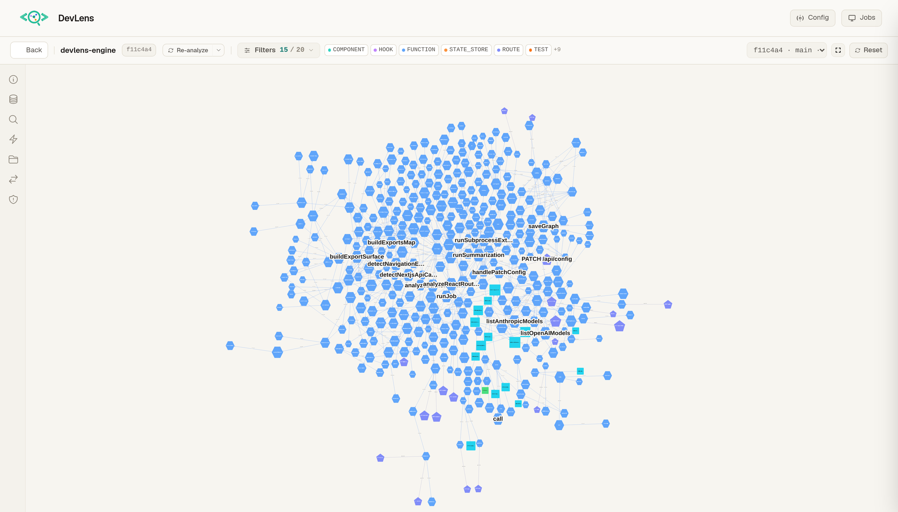
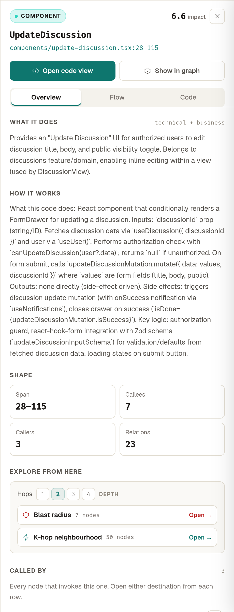
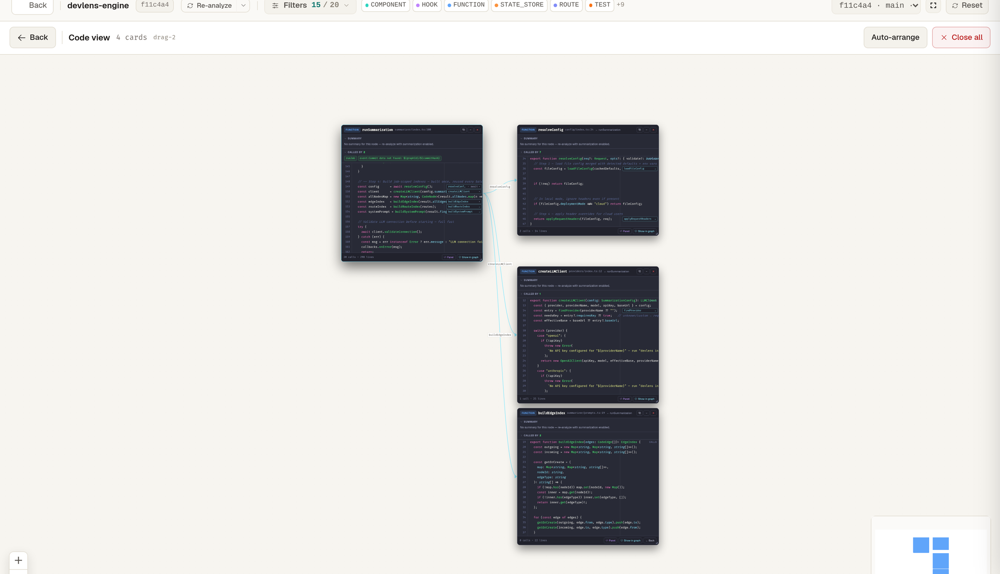

# `frontend` — the DevLens Web UI

An interactive codebase-graph explorer built with **Next.js 16**. Two canvases, one graph: a **Cytoscape** force-directed map of the whole repo, and a **React Flow** "code view" where each node becomes a draggable, resizable card of real source.

It talks to the DevLens backend API (`src/server`) and renders the analyzed graph: node detail with AI summaries, ordered call flow, blast radius, commit diffs, security findings, and live job progress.



The graph view lives under a **dynamic route** (`/graph/[graphId]`), because a user analyzes new repos after installing DevLens — the graph id isn't known at build time. So the frontend is built and run as a **live Next.js server** (`next build` → `next start`), which renders *any* `/graph/<id>` on demand. `bun start` runs that live server on a single port (via a Bun proxy): `/api/*` is handled by the DevLens API router, and everything else is proxied to the Next server — so the UI and API stay on one port and graph navigation works for graphs created after startup.

## Stack

- **Next.js 16** (App Router) + **React 19**
- **Cytoscape** + `cytoscape-fcose` — the repo canvas and its force-directed layout
- **@xyflow/react** (React Flow) — the code view: draggable cards, routed edges, fit/arrange
- **@tanstack/react-query** — server state, polling, and cache for graph/node/job data
- **highlight.js** + **dompurify** — syntax-highlighted source and sanitised summary HTML
- **react-toastify** — action feedback (submit, failure, retry)

## Layout

```
frontend/
├── app/                    # App Router: home (repo list), /graph/[graphId], globals.css
├── components/
│   ├── graph/              # GraphCanvas (cytoscape), NodePanel, CodeFlow, Sidebar,
│   │                       # SubgraphOverlay, FilterBar + cytoscapeConfig (palette/styles)
│   ├── panels/             # Config and Jobs drawers
│   └── ui/Hint.tsx         # portal tooltip used by every badge
├── lib/                    # api client, react-query hooks, theme tokens, graph algorithms
└── public/                 # static assets
```

## What it shows

<table>
<tr>
<td width="50%"></td>
<td width="50%"></td>
</tr>
<tr>
<td><em>One node: summary, execution pipeline, shape metrics, blast radius, callers, relations.</em></td>
<td><em>Code view: source cards for a function and its calls; click a badge to open the callee.</em></td>
</tr>
</table>

- **Repo canvas** — force-directed layout, focus/dim of the ego network, zoom-dependent labels, node type shapes and colours, entry-point reach highlighting.
- **Node panel** — Overview (what it does, technical summary, ordered pipeline, shape, blast radius / K-hop, called-by, calls, relations, security, details), Flow (all resolved calls in order, each expandable to summary + source; an Upstream tree of callers), and Code. Draggable width.
- **Code view** — the node and its callees as cards. Cards drag, resize from the corner, minimise, and keep a "Called by" list; the top bar has Back / Auto-arrange / Close all.
- **Subgraph overlay** — full neighbourhood, K-hop, or blast radius over the same edges, with its own filters and breadcrumb stack.
- **Sidebar panels** — project info (with one-click reindex), visible nodes, search, highlighted set, files, commit diff, security issues.
- **Control centre** — filter by node type, edge type, score threshold, rendering boundary and entry-point hops, with live counts from your graph.
- **Jobs drawer** — SSE-driven progress per phase, pause/resume/cancel, and the engine's own error text on failure.

## Design system

`lib/theme.ts` is the only palette source and it encodes one product decision: **light chrome, dark code**.

- `UI` — warm paper surfaces for everything that is chrome: toolbar, sidebar, node panel, dialogs, tooltips.
- `CODE` — a Dracula palette for anything that shows source, because developers read code in a dark editor and the code panes should feel like one.

Supporting rules:

- **Node colours are the committed DevLens palette.** On a light canvas the label colour is chosen per fill (`labelColorFor`) instead of assuming white.
- **Typography** — 15px base, 13–14px panel body, 11.5–12.5px metadata; Fira Code for identifiers and counts.
- **Every badge has a tooltip** (`components/ui/Hint.tsx`, portal-based so a scrolling panel cannot clip it), and every node row offers both destinations: open in the graph, open in the code view.
- **Stacking is deliberate** — canvas layers ≤ 50 (sidebar/overlay 20, node panel 30, code view 50), toolbar 60, side drawers 90, tooltips 10000. Dropdowns opened from the toolbar stay above an open code view; drawers are never clipped by the toolbar.
- **`html { color-scheme: light }`** plus pinned React Flow CSS variables: otherwise `prefers-color-scheme: dark` leaks into `light-dark()` defaults and the code-view pane paints itself `#141414` on a dark-mode machine.

## Performance notes

The reference graph this UI is developed against is ~1,200 nodes / 1,700 edges, which is enough to break a naive implementation:

- **Overview labels** are screen-constant for the top 15 nodes (`11 / zoom`), so a fitted 400-node map still names its key nodes; the rest label up as you zoom.
- **Subgraph overlay** caps its BFS at 500 nodes and switches from fcose to breadth-first layout above 350 — a second force layout over most of the graph took the tab down.
- **Canvas updates** only re-layout when the *node set* changes; edge-only filter changes reuse positions, and updates are debounced.
- **Code cards** are memoised and React Flow owns their positions (`useNodesState`), so a drag is a store update rather than a re-render of every highlighted line.
- **Icons** are inlined in `components/icons.tsx` — see below.

## Run

**Production — one command from the repo root** (`bun start` builds the frontend *only when there's no existing build*, then serves UI + API together on a single port; it auto-increments if busy):

```bash
bun install
bun start                # builds on first run, then serves API + Web UI on :3000
# → Web UI:  http://localhost:3000
```

`bun start` is **fast on repeat runs**: it skips the Next.js build when `frontend/.next` already exists (use `bun run start -- --rebuild` to force a fresh build, or `-- --port 4100` to pick a starting port).

> Watch the startup banner: it prints the port it actually bound. If `:3000` was already taken it moves to `:3002` and a browser tab on `:3000` will keep serving the **old** build — the most common "my change didn't apply" trap.

The Web UI runs from the source tree via `bun start` — it is **not** bundled into the installed CLI binary (`devlens serve` is API-only; the Web UI is not part of the CLI distribution).

> Because the UI is a *live* Next server, opening `/graph/<any-new-graph-id>` (from the **Analyzed Repositories** cards, or directly) always renders the graph — even for repos analyzed after the server started.

**Development — hot-reloading** (backend on :3000, frontend on :3001):

```bash
# from the repo root (recommended): backend + frontend together
bun install && bun run dev

# or run just the frontend dev server (expects the backend already running)
cd frontend && bun run dev   # scripts/dev.mjs → next dev -p 3001
```

`frontend/scripts/dev.mjs` is a thin launcher around `next dev` that pins the UI
to **:3001** (so it never collides with the API on :3000 — override with
`NEXT_DEV_PORT`) and raises V8's old-space cap in proportion to machine RAM, so a
cold Turbopack compile of `/graph/<id>` cannot abort the dev server with
`JavaScript heap out of memory`.

Open the printed URL, paste the **absolute path** to a repo (it must have a root `package.json`), and click **Analyze**.

> **API base URL:** in production the UI calls the API on the **same origin** (whatever port `bun start` chose), so no config is needed. In `next dev` it targets `http://localhost:3000` by default. Override with `NEXT_PUBLIC_ENGINE_URL` if the UI and API are on different origins.

## Scripts

| Script | Does |
| :-- | :-- |
| `bun run dev` | `scripts/dev.mjs` → `next dev -p 3001` — hot-reloading dev server (dev only) |
| `bun run build` | `next build` — production build (server mode, `frontend/.next`); served by `bun start` via a live Next server |
| `bun run lint` | `eslint` |
| *(repo root)* `bun run build:ui` | alias for `cd frontend && bun run build` |

### Icons

UI icons live in [`components/icons.tsx`](components/icons.tsx) as inlined SVGs —
**do not import from `react-icons` in app code**. That package only ships barrel
entrypoints, so one named import pulls thousands of icon components into the
module graph (the graph page used to compile ~7.8 MB of icons to render 14 of
them, which is what made `next dev` slow and eventually OOM).

When you need a new icon, reference it in a component and regenerate:

```bash
cd frontend && python3 scripts/gen-icons.py   # writes components/icons.tsx
```

## Backend

The UI is a client of the backend API in [`../src/server`](../src/server), which runs the [`devlensio`](https://www.npmjs.com/package/devlensio) analysis pipeline and streams job progress over SSE. Graphs are persisted under `~/.devlens` and shared with the CLI and MCP server.